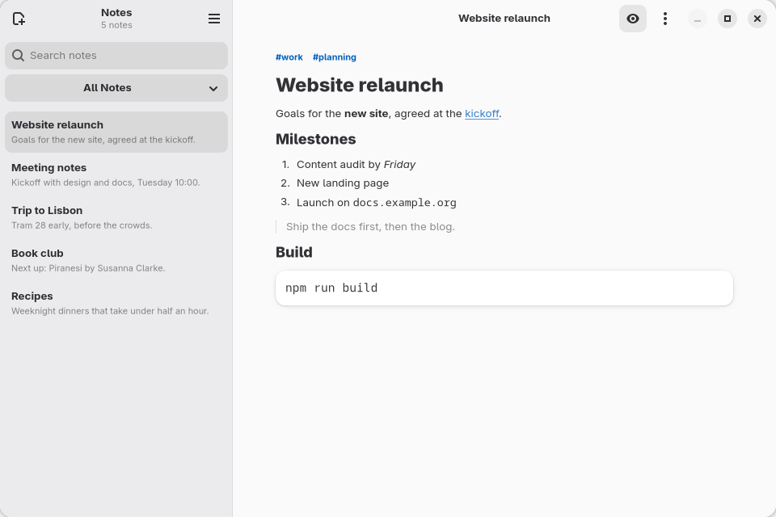

<h1 align="center">
  <picture>
    <source media="(prefers-color-scheme: dark)" srcset="https://raw.githubusercontent.com/gtkx-org/gtkx/main/website/public/logo-wordmark-dark.svg" />
    
  </picture>
</h1>

<p align="center">
  The React framework for Linux<br />
  Adwaita and GTK4 widgets, TypeScript, and Node.js.
</p>

<p align="center">
  <a href="https://www.npmjs.com/package/create-gtkx"></a>
  <a href="https://www.npmjs.com/package/create-gtkx"></a>
  
  <a href="https://github.com/gtkx-org/gtkx/blob/main/LICENSE"></a>
  <a href="https://github.com/gtkx-org/gtkx/actions/workflows/ci.yml"></a>
</p>

<p align="center">
  <a href="https://gtkx.dev">Homepage</a> &middot;
  <a href="https://gtkx.dev/v2/guide/getting-started">Documentation</a> &middot;
  <a href="https://github.com/gtkx-org/gtkx/tree/main/examples">Examples</a> &middot;
  <a href="https://gtkx.dev/contributing/">Contributing</a> &middot;
  <a href="https://opencollective.com/gtkx">Sponsor</a>
</p>

GTKX brings the workflow of modern web development to native GTK and Adwaita apps: declarative UI with React, a dev server with Fast Refresh, native UI tests in Vitest, and Flatpak, Debian, RPM, and AppImage packaging. [Why GTKX](https://gtkx.dev/v2/guide/why-gtkx) explains the approach, and [Comparisons](https://gtkx.dev/v2/guide/comparisons) sets it against GJS, node-gtk, React Native, and gtk4-rs and Relm4.

## Start an app

This branch develops **GTKX 2.0**, currently in beta. The stable release is scheduled for **1 December 2026**. For the current stable release, use the [1.x documentation](https://gtkx.dev/guide/getting-started).

GTKX 2.0 requires Linux, Node.js 26.7 or later, GTK 4.20 or later, libadwaita 1.8 or later, and native development libraries. Follow [Getting Started](https://gtkx.dev/v2/guide/getting-started) to install and check them before scaffolding:

```sh
npm create gtkx@beta my-app
cd my-app
npm run dev
```

The native addon ships prebuilt for x64 and arm64 glibc Linux. Building it from source requires Rust and the [workspace prerequisites](https://gtkx.dev/contributing/development).

## Build with React

GTKX renders native Adwaita and GTK widgets. Use React state and events to update them, Node.js for filesystem and network access, and npm packages that do not require a browser DOM.

This is a complete entry point in a scaffolded app:

```tsx
import {
  AdwApplication, AdwApplicationWindow,
  AdwHeaderBar, AdwToolbarView,
} from "@gtkx/jsx/adw";
import { GtkLabel } from "@gtkx/jsx/gtk";
import { createRoot, quit } from "@gtkx/react";

const App = () => (
  <AdwApplication>
    <AdwApplicationWindow title="My App" onCloseRequest={() => quit()}>
      <AdwToolbarView top={<AdwHeaderBar />}>
        <GtkLabel>Hello from GTKX</GtkLabel>
      </AdwToolbarView>
    </AdwApplicationWindow>
  </AdwApplication>
);

createRoot().render(<App />);
```

The CLI generates `@gtkx/jsx` elements and `@gtkx/gi` bindings from your configured native libraries. These generated packages live in your app’s `node_modules`.

## Learn GTKX

<p align="center">
  
</p>

<p align="center">
  <em>The Notes app you build in the <a href="https://gtkx.dev/v2/tutorial/">tutorial</a>.</em>
</p>

- [Tutorial](https://gtkx.dev/v2/tutorial/): build the Notes app, test it, and package it for distribution.
- [Guides](https://gtkx.dev/v2/guide/why-gtkx): forms, navigation, animation, styling, testing, and deployment.
- [API reference](https://gtkx.dev/v2/reference/): GTKX package exports. Widget props are documented in the generated `.gtkx/reference/` in your app.
- [Examples](https://github.com/gtkx-org/gtkx/tree/main/examples): a counter, a WebKitGTK browser, ports of the GTK and libadwaita demos, spring animations, navigation, and Storybook stories.

## Packages

Apps created with `create-gtkx` already depend on the packages they need to run and test. Add libraries as your app needs them.

| Package                                   | Description                                                           |
| ----------------------------------------- | --------------------------------------------------------------------- |
| **Apps**                                  |                                                                       |
| [`create-gtkx`](packages/create-gtkx)     | Create native GTK and Adwaita apps with React and GTKX.               |
| [`@gtkx/react`](packages/react)           | React renderer for native GTK and Adwaita apps.                       |
| [`@gtkx/cli`](packages/cli)               | Development and packaging commands for GTK apps built with GTKX.      |
| [`@gtkx/config`](packages/config)         | Typed configuration for GTK apps built with GTKX.                     |
| **Libraries**                             |                                                                       |
| [`@gtkx/components`](packages/components) | GTK collection views, selection controls, and toasts for React.       |
| [`@gtkx/css`](packages/css)               | CSS-in-JS styling for GTK widgets in GTKX.                            |
| [`@gtkx/navigation`](packages/navigation) | React Navigation navigators for GTK and Adwaita apps.                 |
| [`@gtkx/forms`](packages/forms)           | React Hook Form controls for GTK and Adwaita apps.                    |
| [`@gtkx/animated`](packages/animated)     | React Spring animations for GTK widgets in GTKX.                      |
| [`@gtkx/i18n`](packages/i18n)             | Gettext localization for GTK apps through react-i18next.              |
| [`@gtkx/cairo`](packages/cairo)           | Cairo drawing for GTK apps built with GTKX.                           |
| [`@gtkx/gl`](packages/gl)                 | OpenGL 4.6 core bindings for GTK GL areas in GTKX.                    |
| **Testing and tools**                     |                                                                       |
| [`@gtkx/testing`](packages/testing)       | Test GTKX apps against real GTK widgets.                              |
| [`@gtkx/vitest`](packages/vitest)         | Vitest plugin that runs GTK tests in isolated headless displays.      |
| [`@gtkx/storybook`](packages/storybook)   | Storybook stories for native GTK components built with GTKX.          |
| [`@gtkx/mcp`](packages/mcp)               | MCP tools for GTKX docs and running GTK apps.                         |
| **Bindings and internals**                |                                                                       |
| [`@gtkx/codegen`](packages/codegen)       | Generate TypeScript and JSX bindings for GTK and GObject libraries.   |
| [`@gtkx/runtime`](packages/runtime)       | Runtime for generated GTK and GObject Introspection bindings in GTKX. |
| [`@gtkx/native`](packages/native)         | Native Node.js addon for GTKX calls into GTK and other C libraries.   |
| [`@gtkx/utils`](packages/utils)           | Shared Node.js utilities for GTKX, the React toolchain for GTK.       |

## Contribute

See [CONTRIBUTING.md](CONTRIBUTING.md) for setup and checks, the [Code of Conduct](CODE_OF_CONDUCT.md), and the [security policy](SECURITY.md). Architecture and maintainer procedures are in the [contributor docs](https://gtkx.dev/contributing/).

## Support GTKX

[Contribute through Open Collective](https://opencollective.com/gtkx) to help cover recurring costs. Our [funding plan](FUNDING.md) explains expenses, fees, and the operating reserve.

## Credits

[Why GTKX](https://gtkx.dev/v2/guide/why-gtkx#credits) credits the projects GTKX builds on.

## License

[MPL-2.0](LICENSE).
