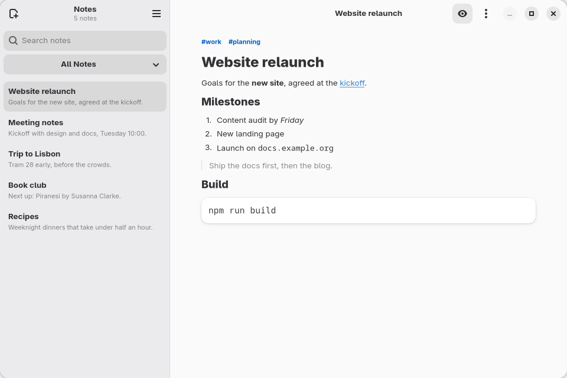

# Notes

Notes is the Markdown notes app built in the [GTKX tutorial](https://gtkx.dev/v2/tutorial/). It keeps each note as a plain `.md` file in a folder, renders Markdown as native widgets, searches the full text in a worker, filters by tag, completes links to other notes, and shows changes other programs make to the folder while it runs.



This app is excluded from the pnpm workspace and installs the GTKX packages declared in [package.json](package.json). Install the [native prerequisites](https://gtkx.dev/v2/guide/getting-started), GtkSourceView 5 and the gettext tools, then run from this directory:

```bash
npm install
npm run dev
```

Notes reads `Notes` in your Documents folder; choose another folder in Preferences. Run `npm run typecheck` to check application types. Install the [headless test dependencies](https://gtkx.dev/v2/guide/testing#setup), then run `npm test` to check application behavior and compiled translations, and `npm run storybook` to browse the preview's stories.

Follow the [tutorial](https://gtkx.dev/v2/tutorial/) to build the app step by step.
