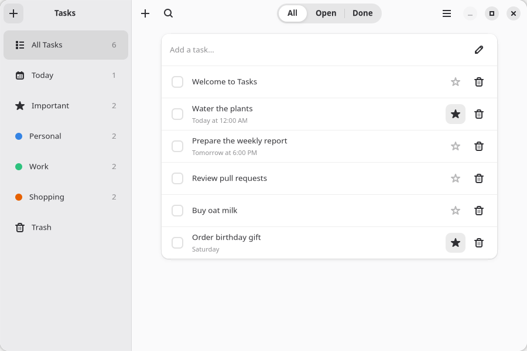

# Tasks

Tasks is the Linux task manager built in the [GTKX tutorial](https://gtkx.dev/v2/tutorial/). It organizes tasks into lists, saves changes between sessions, and sends due-date reminders while running.



This app is excluded from the pnpm workspace and installs the GTKX packages declared in [package.json](package.json). Install the [native prerequisites](https://gtkx.dev/v2/guide/getting-started), then run from this directory:

```bash
npm install
npm run dev
```

Run `npm run typecheck` to check application types. Install the [headless test dependencies](https://gtkx.dev/v2/guide/testing#setup), then run `npm test` to check application behavior, timezone handling, and compiled translations.

Follow the [tutorial](https://gtkx.dev/v2/tutorial/) to build the app step by step, or go directly to [desktop integration](https://gtkx.dev/v2/tutorial/actions-menus-shortcuts) and [packaging](https://gtkx.dev/v2/tutorial/packaging).
